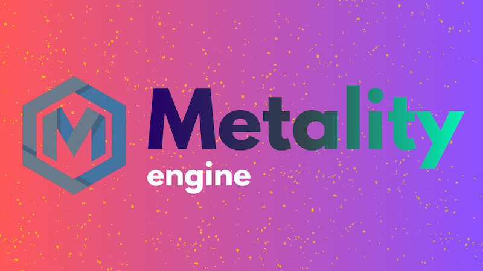

# Metality Engine

A native Apple Silicon (Metal) rendering and shader engine for **Minecraft 26.3 (Fabric)** on macOS.

Built for smooth high-FPS gameplay, lower heat, built-in Connected Glass, and modern shader packs.

---

## Requirements

- **Mac**: Apple Silicon (`M1` / `M2` / `M3` / `M4` / `M5`)
- **macOS**: `15.0` or newer
- **Minecraft**: `26.3` with **Fabric Loader** (`>= 0.19.5`), **Fabric API**, and **Java 25**

---

## Installation

1. Download `metality-mc26.3-0.1.0-beta.1.jar` from [Releases](https://github.com/xushiexpresso15/Metality-Engine/releases).
2. Place it in your Minecraft `mods` folder (alongside Fabric API).
3. Launch Minecraft.
   - Open **Video Settings** to adjust graphics, **MetalFX** upscaling, or **Connected Glass**.
   - Press **`O`** (or open **Video Settings → Shader Packs**) to manage shaders.

---

## Key Features

- **Native Apple Metal Rendering**: Runs directly on Metal instead of OpenGL for faster frame times and better battery life.
- **Built-in Connected Glass**: Seamless connected glass blocks and glass panes — works both with and without shaders, including custom resource packs.
- **MetalFX Upscaling**: Higher frame rates on Retina displays with clean image quality.
- **Shader Pack Support**: Works with [Meteor Shader](https://github.com/xushiexpresso15/Meteor-shader) (`Meteor Dusk` & `Meteor Zenith`) and compatible Iris/Aperture shader packs.

---

## Building from Source

Requires macOS `arm64`, Xcode Command Line Tools, `cmake >= 3.25`, `gradle`, and JDK 25:

```bash
gradle :core:buildNativeMetalCore :mod:build
```

The built mod JAR will be in `mod/build/libs/`.
See [CHANGELOG.md](CHANGELOG.md) for release notes and [docs/VERSIONING.md](docs/VERSIONING.md) for versioning rules.

---

## License

[Apache-2.0](LICENSE)
